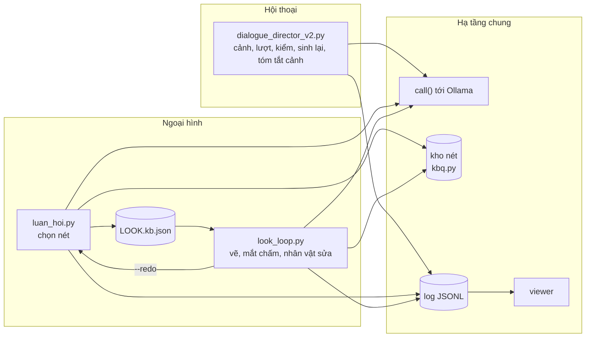
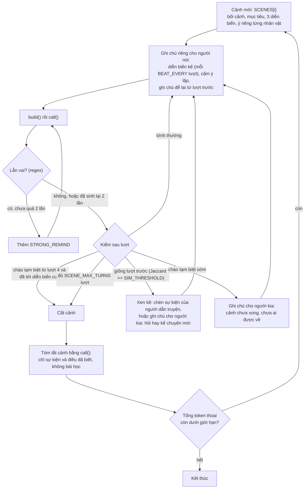
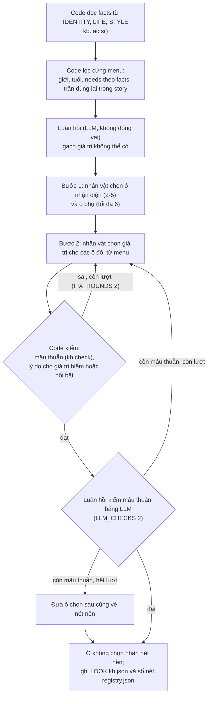
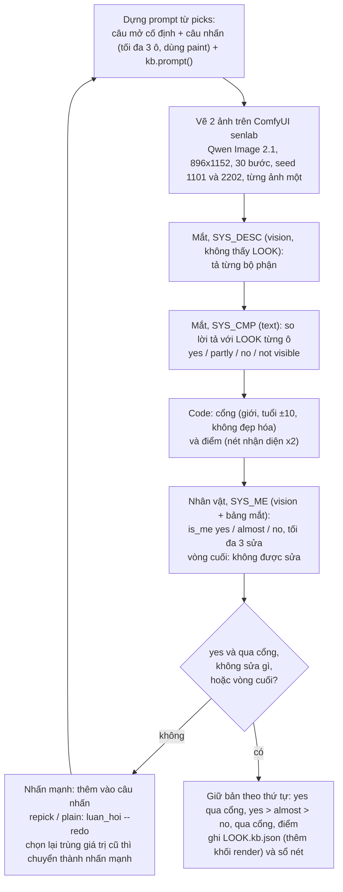

# Harness nhan_vat: kiến trúc hiện tại (2026-11-27)

Tài liệu kỹ thuật cho người sửa code. Mục tiêu và bài học: `look_and_feel.md`; số liệu thí nghiệm hội thoại:
`experiments/TEST_PROTOCOL.md`; việc còn lại: `characters/BACKLOG.md`.

## 1. Harness này là gì

Harness điều phối bằng code. Model chỉ trả lời **từng lời gọi một**: nói một lượt thoại, chọn một giá trị, tả một tấm ảnh. Vòng
lặp, luật, kiểm tra, cắt cảnh, sinh lại, ghi log đều do code Python làm. Model không gọi tool, không tự quyết bước kế tiếp.
Lý do: model nhỏ chạy local (gemma4 e4b và 26b) không giữ được vai hay luật nếu để tự chạy (lẫn vai từ khoảng 2k token khi không
có đạo diễn).

Ba khối:

Mỗi script là một file chạy độc lập (`python -I <script>`), chỉ dùng thư viện chuẩn. Code dùng chung duy nhất là module kho nét
`characters/kb/kbq.py`; `call()` và đọc tham số (`opt()`) được chép lại trong từng script.

## 2. Lời gọi model

Mọi script gọi Ollama `/api/chat` qua `urllib`, `stream: false`, `think: false`.

| | Hội thoại | Ngoại hình (luan_hoi, look_loop, các bài thử) |
|---|---|---|
| model | `gemma4:e4b-it-q4_K_M` trên máy (mặc định), `--model` để đổi | `gemma4:26b` trên wee |
| máy | `http://localhost:11434` (mặc định), `--api` để đổi | `http://wee:11435` |
| đầu ra | văn bản tự do | JSON theo schema (`format: <JSON schema>`) |
| tham số gửi | `temperature 0.8`, `num_predict`, `seed`; local thêm `num_ctx 8192`, `keep_alive` | không gửi `options` |
| khi lỗi | HTTP lỗi: thử lại tối đa 4 lần, tăng `repeat_penalty` | JSON hỏng: hỏi lại tối đa 3 lần |
| ảnh | không | `images` base64 trong message (vision) |

Luật máy dùng chung (wee): gọi tuần tự từng lời một; không gửi `num_ctx`, `keep_alive`, `options` (làm wee nạp lại model).
Schema JSON là cách chính để giữ model nhỏ trong khuôn: `enum` cho lựa chọn đóng, `maxItems` cho số lượng, `maxLength` cho câu.
Code luôn kiểm lại sau khi nhận (schema không đủ chặn ý sai).

## 3. Hội thoại: đạo diễn v2 (`experiments/dialogue_director_v2.py`)

Hai nhân vật cùng một model, mỗi bên một system prompt riêng. Đạo diễn là luật, không phải LLM (LLM chỉ dùng để tóm tắt cảnh).

**Vòng chạy**

**Dựng prompt mỗi lượt (`build`)**
1. `system`: lời vai của người đang nói.
2. Tin đầu: tối đa `MAX_SUMMARIES` tóm tắt cảnh trước + bối cảnh cảnh này.
3. Các lượt của cảnh hiện tại: lượt của chính mình là `assistant`, lượt của người kia và người dẫn truyện là `user`.
4. Cuối tin `user` cuối cùng: ý riêng trong cảnh + các ghi chú của đạo diễn + câu nhắc vai (`REMIND`).
   Phần này **không lưu vào bản thoại chung**, chỉ sống một lượt.

Chỉ cảnh hiện tại nằm nguyên văn trong context; cảnh cũ chỉ còn tóm tắt. Nhờ vậy prompt mỗi lượt dưới khoảng 3k token dù câu
chuyện dài bao nhiêu.

**Kiểm lẫn vai:** regex trên câu của Lão Bảy (`lao_bleed`): tự xưng "ông", "Dạ", tiếng Anh, emoji, nhận là AI, có code, "mình"
kiểu Minh. Câu của Minh không bị kiểm.

**Tham số chính:** `NUM_CTX 8192`, `SCENE_MAX_TURNS 18`, `BEAT_EVERY 5`, `MAX_SUMMARIES 6`, `SIM_THRESHOLD 0.30`,
`THEME_WINDOW 12`, `THEME_SHARE 0.35`.

**Log:** `experiments/logs/director2_log_s<seed>.jsonl` (model mặc định) hoặc `director2_<model>_s<seed>.jsonl`. Mỗi dòng là một
trong: mở cảnh (`scene_start`, `goal`, `beats`), một lượt (`speaker`, `prompt_tokens`, `dialogue_tokens`, `raw_bleed`,
`final_bleed`, `regens`...), sự kiện chèn (`event`), cắt cảnh (`cut`, `summary`). Chấm: `score.py`, `rescore.py`.

Các bản khác: `_v2_en` (cùng cơ chế, bối cảnh làng chài Cornwall, tiếng Anh); `_v3` thêm sổ nhớ cho từng nhân vật, `_v31` thêm
chặn kể lại: kể lại ít hẳn nhưng chậm hơn khoảng 35%, đang gác.

## 4. Ngoại hình

### 4.1 Kho nét (`characters/kb/`)
- Nguồn sự thật: `catalog/<ô>.jsonl`, một giá trị mỗi dòng; từ vựng đóng ở `vocab.json` (42 ô, nhóm A-H, dải tuổi, facets đời
  sống, luật lý do). `kb.py check` kiểm, `kb.py build` dựng `kb.json`. Chi tiết: `characters/kb/README.md`, `AGENTS.md`.
- `kbq.py` là API cho script. Hàm hay dùng:

| Hàm | Làm gì |
|---|---|
| `kbq.load()` | nạp `kb.json` |
| `kb.facts(identity, life, style)` | đọc đời sống từ hồ sơ -> `facts.ctx` (giới, dải tuổi, dân tộc, tag) |
| `kb.baseline(slot, ctx)` | nét nền của ô theo giới x tuổi x dân tộc |
| `kb.notable(v, ctx)` / `kb.needs_cite(...)` | giá trị nổi bật / giá trị cần lý do |
| `kb.cite_problem(...)` | lý do nhân vật đưa ra có khớp nguyên nhân của giá trị không |
| `kb.check(picks, ctx)` | mâu thuẫn giữa các ô (luật `rules.jsonl`, trục, vùng) |
| `kb.phrase(pick)` / `kb.paint(pick)` | cụm chữ của giá trị / câu riêng cho prompt vẽ (nếu có `paint`) |
| `kb.prompt(picks, ctx, groups=...)` | ghép prompt từ các ô, theo thứ tự cố định |
| `kb.items(picks)` | duyệt (ô, giá trị), kể cả ô nhiều giá trị (`marks`) |

### 4.2 Luân hồi (`experiments/luan_hoi.py`)

Giới hạn: tối đa 5 nét nổi bật; nét nhận diện tối đa 3 trong một nhóm ô; trùng nét nhận diện với một nhân vật khác cùng story
tối đa 1; một giá trị chỉ được bấy nhiêu nhân vật cùng nhóm (giới x tuổi) trong story dùng: `max(CAP_MIN 2, CAP_SHARE 0.2 x số
nhân vật của nhóm)`.

`--redo <file>`: look_loop gọi để chọn lại vài ô của LOOK đang có. Chỉ xét các ô đó (`touched`): giá trị đang có luôn ở đầu
menu; kiểm mâu thuẫn chỉ tính mâu thuẫn dính tới ô đang chọn lại; lượt kiểm cuối chỉ được bỏ ô đang chọn lại.

Log: `experiments/logs/luan_hoi.jsonl` (mỗi lần chạy một dòng, có từng bước); `rule_candidates.jsonl` (mâu thuẫn LLM báo,
`acted` cho biết code có hành động không, để người duyệt thành luật kho).

### 4.3 Vòng ảnh (`experiments/look_loop.py`)

Vòng cuối model vẫn có thể trả về sửa (nếu server bỏ qua `maxItems 0`): code chỉ ghi vào `changes_ignored`, không áp.
Cần harness ngoài repo `render_t2i.py` (`C:\Users\khoa\xyz\hoa_si\qwen\research_v2\harness`) để dựng workflow ComfyUI.
Ghi: `experiments/look_loop/<id>/<ts>/` (LOOK, prompt, log redo từng vòng; ảnh PNG chỉ ở máy, bị `.gitignore`) và
`experiments/logs/look_loop.jsonl` (một dòng mỗi vòng: prompt, ảnh, lời mắt, điểm, cổng, câu trả lời của nhân vật, `stop`).

## 5. Log và viewer

- Mọi script ghi `experiments/logs/*.jsonl`, một dòng một sự kiện, không bao giờ ghi đè file khác loại. Các bài thử offline
  (`eval_eye`, `choose_test`, `choose_rate`) ghi thêm vào cuối và bỏ qua lời gọi đã có, nên chạy lại sau khi bị ngắt được.
- `viewer/serve.py` (cổng 8765) phục vụ `viewer/index.html` để đọc log trên trình duyệt; đổi định dạng log thì cập nhật viewer.

## 6. Mở rộng

- **Thêm nhân vật:** tạo `characters/<id>/` với IDENTITY, SOUL, LIFE (bản `.md` và `.en.md`), theo `characters/SPEC.md`; chạy
  `char_style_look.py` cho STYLE, `luan_hoi.py <id> --story <story>` cho LOOK, rồi `look_loop.py <id>`.
- **Thêm giá trị vào kho:** `kb.py find "<cụm>"` để tránh trùng, thêm dòng vào `catalog/<ô>.jsonl` (có nguồn), `kb.py build`.
- **Thêm luật đạo diễn:** thêm vào vòng lượt trong `dialogue_director_v2.py` (ghi chú riêng trước lượt, hoặc kiểm sau lượt rồi
  sinh lại); log luật mới vào bản ghi lượt để `score.py` đếm được.
- **Thêm thí nghiệm:** theo mẫu `choose_rate.py`: `opt()` đọc tham số, `call()` tuần tự, log JSONL ghi thêm và bỏ qua phần đã có,
  `--dry` in prompt mà không gọi model, `--report` đếm kết quả.

## 7. Chỗ yếu của harness

- **Không có lõi dùng chung:** `call()`, `opt()`, đọc hồ sơ chép ở từng script; sửa luật gọi máy phải sửa nhiều chỗ.
- **Đạo diễn và hồ sơ tách nhau:** lời vai trong `dialogue_director_v2.py` viết cứng, chưa đọc IDENTITY/SOUL/LIFE/STYLE.
- **Đạo diễn gửi `options` (temperature, num_predict, seed) cả khi chạy trên wee**, trái luật wee mà các script ngoại hình đã sửa.
- **Luật đạo diễn viết liền một khối** trong vòng lượt; muốn bật tắt từng luật để thử thì phải sửa code.
- **Ít test tự động:** chỉ có `characters/kb/tests/golden.jsonl` cho kho nét; các script còn lại kiểm bằng `--dry` và chạy thật.
- **Model nhỏ không tự đánh giá được ảnh của mình:** cho nhân vật chọn giữa các bản thì chọn theo vị trí; chấm riêng thì điểm dồn
  về 7 (`choose_test.py`, `choose_rate.py`). Quyết định cuối của vòng ảnh vì vậy do code.
