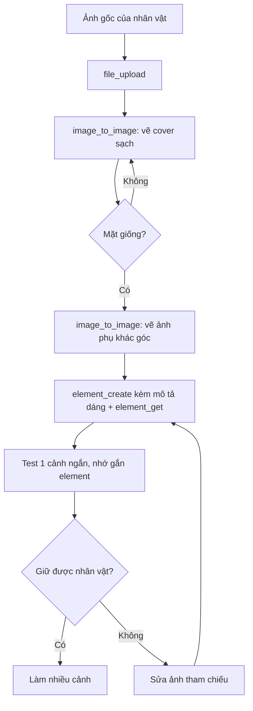

# Kling: look and feel

Ghi chép về cách dùng Kling MCP để làm hình ảnh nhân vật. Tra cứu và thử ngày 2026-11-28, MCP 1.3.3.

Mức độ tin cậy được ghi theo ba loại:
- **MCP:** lấy từ mô tả tool hoặc kết quả `who_am_i`.
- **Đã chạy:** đã thử thật.
- **Chưa kiểm chứng:** lấy từ guide, tìm kiếm web hoặc suy đoán.

**Tình trạng:** đã chạy 1 job `image_to_image`. **Chưa tạo element nào, chưa làm video nào.**

---

## 1. Tài khoản và credit

- Kết nối MCP đăng nhập bằng OAuth, gọi được (đã chạy). Nếu server báo danh sách tool đã cập nhật thì reconnect Kling MCP hoặc mở lại app.
- Gói **VIP Standard**, **660 credits mỗi tháng**. Trang gói ghi 100 credits = $0.76, giá $60 năm đầu, sau đó $79.2/năm.
- Mọi job tạo ảnh hoặc video đều tốn credit, nên phải chốt tham số trước khi chạy. Không gửi job thử cho vui, không tự gửi lại job. Tạo, sửa, xem element không phải là job tạo ảnh (MCP).

Quyền lợi ghi trên trang gói (từ ảnh chụp màn hình, ảnh không ghi thời hạn):

| Dòng | Ghi chú |
|---|---|
| Kling 4.0 – HDR: Free | Hiểu là cho **video**. Chưa kiểm chứng "free" là miễn phụ phí HDR hay miễn cả lượt tạo |
| Kling Image 4.0 - 8K: 40% Off | Ảnh 8K được giảm giá, không miễn phí. 8K vượt giới hạn ở mục 2 |
| VIDEO 2.6 - Voice Control: Free | Chưa thử |
| Element AI Multi-Shot: 3 lượt miễn phí mỗi ngày | Chưa thử |
| Daily Free Credits | Không ghi mỗi ngày bao nhiêu |

Cũng có: xếp hàng không giới hạn số task, ưu tiên tốc độ, video 1080p/4K, bỏ watermark, được dùng thương mại.

### Giá đã biết

| Cấu hình | Giá | Mức tin cậy |
|---|---|---|
| `image_to_image`, `kling-image-v4_0`, `2k`, `3:4`, 1 ảnh, 1 ảnh tham chiếu | **4 credits** (số dư 660 → 656) | đã chạy |
| Cấu hình khác | chưa biết | |

- Kết quả lúc gửi job có trường `creditsConsumed`. Có thể đối chiếu thêm bằng `query_membership_and_credits`.
- `who_am_i` không trả giá. Với GPT-Image, nó chỉ ghi `quality` ảnh hưởng tới giá.
- Giá **API** của Image 3.0 Omni: 8 đơn vị (khoảng $0.028) cho 1K/2K, 16 đơn vị (khoảng $0.056) cho 4K ([tài liệu giá](https://kling.ai/document-api/pricing/base/image.md), mới xem qua kết quả tìm kiếm). Đây là đơn vị API, **không trừ vào credit của gói**.
- Số credit trên Invideo, Artlist, Magnific là credit riêng của họ, không quy đổi được.

---

## 2. Giới hạn khi tạo (chốt 2026-11-28)

- **Ảnh:** độ phân giải **từ 2K trở xuống**. Không dùng 4K, 8K.
- **Video:** độ phân giải **từ 2K trở xuống**, tức chọn `720p` hoặc `1080p`, không dùng `4k`. Thời lượng **tối đa 5s**.
- **Luôn truyền rõ độ phân giải và `duration`**, đừng dựa vào mặc định (MCP):
  - `kling-video-v4_0` và `v4_0_flash` mặc định `duration` 10s.
  - `image_to_image` với `kling-image-v3_0_omni` mặc định `4k`.
  - `kling-image-v3_0` mặc định `1k`.
- `kling-video-v2_5`, `v2_6` chỉ có 5s hoặc 10s, `kling-video-o1` ở `text_to_video` cũng vậy, nên chỉ được chọn 5s.

---

## 3. Element là gì

Element là một **đối tượng tham chiếu dùng lại** qua nhiều job, để giữ nó giống nhau giữa các cảnh. Không chỉ là nhân vật. Mỗi element phải có ít nhất 1 tag (MCP):

| Tag | Dùng cho | Gợi ý (chưa kiểm chứng) |
|---|---|---|
| `Characters` | nhân vật | mặt và dáng cố định, đồ mẫu và mô tả dáng theo mục 4.1 |
| `Costumes` | trang phục | chụp riêng bộ đồ trên nền trơn: trước, sau, cận chi tiết |
| `Scenes` | bối cảnh (hiểu theo tên tag, tool không giải thích) | ảnh không có người của cùng một nơi, vài góc. Chỉ nên tạo khi nơi đó lặp lại qua nhiều cảnh |
| `Animals`, `Items`, `Effects`, `Others` | con vật, đồ vật, hiệu ứng, khác | |

Ghép nhiều element trong một job được, ví dụ nhân vật + trang phục + bối cảnh. Chưa thử xem Kling giữ chi tiết đồ và bối cảnh tới đâu, hay các element có bị lẫn nhau không. Đồ nhiều chi tiết (đính đá, corset) dễ có nguy cơ sai.

Đồ chỉ mặc một lần, nơi chỉ xuất hiện một lần thì tả bằng chữ trong prompt là đủ.

### 3.1 Tool (MCP)

| Tool | Việc |
|---|---|
| `element_create` | Tạo element từ ảnh hoặc video có sẵn. Tool này **không tự vẽ** |
| `element_list` / `element_get` | Xem danh sách / chi tiết |
| `element_update` / `element_delete` | Sửa / xoá. Update ghi đè toàn bộ, nên phải `element_get` trước rồi gửi lại đủ trường |
| `file_upload` | Đưa ảnh trên máy lên Kling để lấy URL. `element_create` chỉ nhận URL public |

### 3.2 Gọi element: không có trigger word như LoRA (MCP)

Element được gắn vào job bằng **ID**, ở 2 chỗ:

1. Tham số `elements`: `[{"id": "111", "bindName": "Linh"}]`
2. Trong prompt: `<<<111>>>` ở chỗ đối tượng xuất hiện. Một ID có thể nhắc nhiều lần.

```
<<<111>>> wearing <<<222>>>, sits by the window in <<<333>>>, reading a letter.
```

`111`, `222`, `333` và `Linh` chỉ là ví dụ. Mọi ID trong prompt phải được khai trong `elements`.

| | LoRA | Element của Kling |
|---|---|---|
| Cách tạo | Train ra file trọng số | Đăng ký ảnh hoặc video tham chiếu. Chưa thấy tài liệu nào nói có bước train |
| Cách gọi | Nạp LoRA, thường kèm trigger word | ID trong `elements` và `<<<ID>>>` trong prompt |
| Dùng ở đâu | Tùy model gốc | Xem bảng 3.3 |

### 3.3 Model nào dùng được element (MCP)

| Tool | Model | Số element tối đa | Loại element |
|---|---|---|---|
| `image_to_image` | `kling-image-v4_0` | 10 (ảnh tham chiếu cũng tính vào) | ảnh |
| `image_to_image` | `kling-image-v3_0_omni`, `v3_0`, `o1` | 10 | ảnh |
| `image_to_video` | `kling-video-v3_0` | 3 | ảnh, video |
| `image_to_video` | `kling-video-v3_0_omni` | 7 | ảnh, video |
| `image_to_video` | `kling-video-o1` | 7 | ảnh |

- **Không có `elements`:** `text_to_image`, `text_to_video`. Ở `image_to_image`: các model Gemini, GPT-Image và `kling-image-v2_1`. Ở `image_to_video`: `v4_0` (model mặc định), `v4_0_flash`, `v3_0_turbo`, `v2_5`, `v2_6`.
- `omni_ref_video` nghe nói nhận cả chủ thể (subject) làm tham chiếu, nhưng chưa xem tham số của tool này.
- Đã có element thì truyền ID element, đừng thay bằng ảnh cover hay mô tả chữ.

### 3.4 Spec cứng

Hai nguồn lệch nhau thì lấy mức chặt hơn.
- PNG/JPG, ≤ 30MB, dưới 4K, mỗi cạnh ≥ 300px. WebP phải đổi định dạng trước.
- Tỉ lệ khung **từ 1:2 tới 2:1**. Tool upload của MCP chặn ở 1:2, còn docs API của Kling cho tới 1:2.5.
- Element kiểu ảnh: **1 ảnh cover + 1–3 ảnh phụ**, tổng 2–4 ảnh, không tạo được từ 1 ảnh.
  - **Cover không đổi được sau khi tạo**, muốn đổi phải xoá rồi tạo lại.
  - Ảnh phụ thì thay được, nhưng mỗi lần update là thay cả danh sách.
- Element kiểu video: 1 clip 3–60s, fps > 23.8, cạnh ngắn ≥ 700px, ≤ 4K, SAR để trống, 1:1 hoặc 0:1, không HDR.
- Giọng `.mp3` không bắt buộc.

---

## 4. Ảnh tham chiếu cho nhân vật

### 4.1 Quy định của repo (chốt 2026-11-28)

1. **Ảnh tham chiếu dùng để tạo element nhân vật phải mặc bikini.** Mục tiêu là **giúp cố định dáng**. Dùng bikini trơn kiểu thể thao, che vừa phải, tư thế đứng trung tính, không trang sức.
   - Chỉ áp dụng cho **nhân vật nữ trưởng thành**, hư cấu (AI). **Không bao giờ áp dụng cho nhân vật trẻ em hoặc vị thành niên.** Nhân vật nam chưa chốt đồ mẫu.
   - Người thật phải đồng ý.
2. **Khi tạo element phải có mô tả dáng nhân vật.** `element_create` không có prompt, nên phần này ghi vào trường `description`: viết bằng tiếng Anh, khớp với ảnh, tả chiều cao nhìn qua ảnh, vai, eo, hông, khổ người. Tool không bắt buộc, đây là quy định của repo.
- Prompt từng cảnh **luôn tả rõ quần áo**, để bikini trong ảnh mẫu không bị bê sang cảnh (đề phòng, chưa kiểm chứng).
- **Chưa kiểm chứng:** bikini giữ dáng tốt hơn đồ khác tới đâu, và Kling có dùng `description` khi vẽ hay không. Chưa tìm thấy yêu cầu nào về quần áo trong spec hay mô tả tool đã xem.

### 4.2 Gợi ý chung

Phần này lấy từ guide, chủ yếu của bên thứ ba (chưa kiểm chứng). Chỗ nào khác mục 4.1 thì theo 4.1.
- **Cover chụp chính diện**, rõ mặt, đủ sáng, nhân vật nổi bật, nền trơn. Chỉ 1 người, không chữ, không watermark.
- **Ảnh phụ phải khác góc.** Gợi ý hay gặp là đủ 4 ảnh: chính diện, nghiêng, sau lưng, cận chi tiết. Chưa có tài liệu chính thức nào của Kling xác nhận con số 4. Cắt cận mặt từ cover thì đủ số ảnh nhưng không có góc mới.
- **Cả bộ chung một mặt, một dáng người.** Đúng nguyên tắc chân dung đã chốt: cố định mặt và dáng, còn tóc và quần áo đổi theo cảnh. Đồ, trang sức, trang điểm cầu kỳ trong ảnh tham chiếu dễ bị bê sang cảnh mới, nên để đơn giản, trung tính (đây là gợi ý, không phải spec).
- Muốn thấy được dáng thì ảnh phải lấy cả thân, không chỉ đầu và vai.
- Thiếu góc thì vẽ bổ sung bằng chính model ảnh của Kling, rồi mới tạo element.
- Nên ghi thêm **mô tả bằng chữ** cho element.
- **Nguồn ảnh:** dùng nhân vật AI, chính mình, hoặc người thật đã đồng ý.

---

## 5. Quy trình



Mỗi bước vẽ ảnh hoặc video tốn credit, nên hỏi trước khi chạy, kể cả khi vẽ lại. Chưa có ảnh gốc thì vẽ bằng `text_to_image`. `kling-image-v4_0` có `story_mode` để ra một bộ ảnh liên quan.

### 5.1 Upload ảnh trên máy (đã chạy)

1. Gọi `file_upload` (tên file, MIME, số byte) để lấy ticket dùng một lần, có hạn.
2. Nếu hiện bảng upload thì chọn file trong bảng. Không có thì POST multipart tới `upload_url` với hai trường `ticket` và `file` (đặt đúng Content-Type).
3. Dùng URL trả về làm input. URL do job Kling sinh ra cũng dùng lại được.

### 5.2 Chạy job (đã chạy)

- Job trả về `generationId` ngay, sau đó hỏi trạng thái bằng `query_tasks`: `QUEUING` → `RUNNING` → `COMPLETED`.
- Job thử mất khoảng 2 phút từ lúc gửi tới lúc xong.
- **URL kết quả hết hạn sau 24 giờ**, cần tải về kịp.
- Có hai URL: `url` và `urlWithoutWatermark`. Watermark chữ "AI Generated" góc trên bên trái đi theo cài đặt trên web.

### 5.3 Viết prompt

- **Trỏ tới ảnh tham chiếu:** viết `图片1`, `图片2`… (nghĩa là "ảnh 1", "ảnh 2", ứng với `image_1`, `image_2`). Đây là cú pháp trong mô tả tool, dùng được trong prompt tiếng Anh. Chưa thử thay bằng "image 1".
- **Khi vẽ ảnh tham chiếu:** tả rõ cái cần giữ (mặt, da, dáng, tóc) và cái cần bỏ (trang sức, trang điểm cầu kỳ, đồ, nền).
- **Khi đã có element:** prompt từng cảnh **tả hành động và bối cảnh, không tả lại mặt**. Quần áo tả theo cảnh. Câu mô tả nhân vật nếu có thì giữ y nguyên chữ giữa các lần chạy.
- Mặt bị trôi thì **sửa ảnh tham chiếu**, đừng cố chỉnh prompt.
- Image-to-video giữ nhân vật tốt hơn text-to-video. Kling 3.0 giữ mặt khá ổn nhưng vẫn có lúc trôi (chưa kiểm chứng). Lỗi hay gặp là tạo element xong mà quên gắn vào job.

---

## 6. Nhật ký thử

### 2026-11-28: cover sạch cho nhân vật thử

- Ảnh gốc: ảnh nhân vật AI do chủ repo tạo trên Kling (PNG 1760×2336, 7.5MB, đầm dạ hội đính đá, đá đính mặt, nền sảnh khách sạn).
- Lý do vẽ lại: ảnh gốc có nền phức tạp, đồ và trang điểm cầu kỳ, người hơi xoay.
- Cấu hình: `image_to_image`, `kling-image-v4_0`, `2k`, `3:4`, 1 ảnh, `story_mode` false.
- Prompt:

```
The same woman as in 图片1. Front view, facing the camera, half-body portrait. Keep the same face, facial features, skin tone, body build, hair color and slicked-back hairstyle. Light natural makeup, no face gems, no gold flakes, no jewelry. Plain fitted grey crew-neck top. Plain light grey studio background, soft even lighting. Neutral relaxed expression. One person only, no text.
```

- `generationId`: `ASEY98-YteZqzq-Y79A2j5_TrVCbul4THqbpKbd6g936ReKA6DbJ4rRRcPfuB21_zhol1A_h`
- Kết quả: job `COMPLETED`, tốn 4 credits. **Chưa đánh giá ảnh** (mặt có giống không, có đúng prompt không).

---

## 7. Còn bỏ ngỏ

- Duyệt cover mới, vẽ ảnh phụ (góc nghiêng, 3/4 thấy dáng), tạo element, test 1 cảnh ngắn.
- Giá credit của các cấu hình khác, nhất là video.
- Chỉ cắt ảnh từ cover làm ảnh phụ thì element giữ mặt tới đâu.
- Element trang phục, bối cảnh giữ chi tiết tới đâu; ghép nhiều element có lẫn không.
- Tham số của `omni_ref_video`, `motion_control`.

---

## Nguồn

[Kling Element Library guide](https://kling.ai/quickstart/klingai-element-library-3-user-guide), [Kling character consistency](https://kling.ai/quickstart/ai-video-character-consistency), [Kling API – Elements](https://kling.ai/document-api/api/video/4-0/elements.md), [Kling API – giá ảnh](https://kling.ai/document-api/pricing/base/image.md), [Magic Hour – Kling 3.0 guide](https://magichour.ai/blog/kling-30-reference-guide), [Atlas Cloud – Kling 3.0 consistency](https://www.atlascloud.ai/blog/guides/how-to-use-kling-3.0-for-character-consistency), [invideo – Kling Omni Elements](https://invideo.io/blog/kling-omni-elements/), và mô tả tool của Kling MCP 1.3.3.
